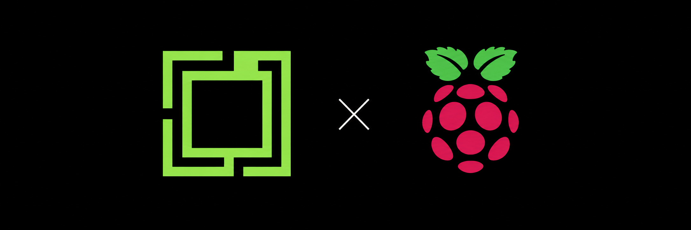

<div align="center">
  

  # Omarchy 4 Pi

  **Tiny board. Big desktop energy.**

  The opinionated Omarchy Quattro desktop, remixed for Raspberry Pi 4 Model B with **4GB+ RAM**.

  [](https://github.com/pkyanam/omarchy-4-pi/actions/workflows/pi-checks.yml)
  [](https://github.com/pkyanam/omarchy-4-pi/releases)
  [](LICENSE)
</div>
  [Manual](manual/)

Hyprland tiling. Quickshell panels. Omarchy themes, launcher, terminal tools, Chromium, and a surprisingly grown-up desktop on a very small computer.

## Omarchy 4.5 candidate

This branch integrates the released Omarchy 4.5 source for **Pi 4 Model B with 4GB and 8GB RAM**. It uses a matching signed stable ARM64 package set, keeps the Pi firmware/U-Boot boot path, and prepares fresh accounts with conservative graphics and build defaults. Paper Mono is bundled with its open font license. Pi 5 qualification is deferred.

Source checks, image assembly, and physical-board validation are separate gates. Follow the [4.5 work ledger](plans/omarchy-4.5-pi4.md) and [design and validation guide](docs/omarchy-4.5-pi4.md) for the current evidence. **This candidate has not been qualified on either Pi 4 memory variant.** The older downloads below contain the previous port.

Use spare media for the 4.5 transition. Existing rolling ALARM installations cannot safely switch to the release library set through a partial update; the new updater refuses that transition. See [updates and recovery](docs/pi-upgrade.md). An unpublished candidate branch also intentionally fails the production updater's `origin/main` check.

## Previously published images

> [!IMPORTANT]
> Independent community port—not an official Omarchy or Raspberry Pi product. **Our first general release is available.** The tested RC1 image has been promoted unchanged, retaining its original `v0.1.0-rc.1` tag and download links. The tester reports it working on their Pi 4; the detailed hardware acceptance checklist remains open. See [release notes](docs/releases/v0.1.0-rc.1.md) and the [hardware checklist](https://github.com/pkyanam/omarchy-4-pi/issues/1).

> **First-release workaround:** disable the screensaver with `omarchy-toggle screensaver-off on`. The original stable image is missing its renderer and can get stuck on idle; screen locking is unaffected. See [recovery instructions](docs/releases/v0.1.0-rc.1.md#known-limits). The new alpha includes the renderer and failure-loop fix.

## Try the 4GB-first alpha

[**v0.2.0-alpha.4**](https://github.com/pkyanam/omarchy-4-pi/releases/tag/v0.2.0-alpha.4) refreshes the Pi port with Omarchy 4.0.4's latest desktop, shell, agent-tooling, and maintenance updates while retaining the Pi-specific installer, update safeguards, and conservative 4GB defaults. It is a prerelease—not a new stable release—and uses stock clocks by default. Flash it to a spare card and keep your working install as rollback. See the [release notes](docs/releases/v0.2.0-alpha.4.md).

Open the **alpha** catalog on macOS:

```bash
open -n -a "/Applications/Raspberry Pi Imager.app" --args --repo \
  "https://github.com/pkyanam/omarchy-4-pi/releases/download/v0.2.0-alpha.4/os-list.json"
```

Choose Pi 4, configure your account/network/hostname in Imager, and verify the target card before writing. First-boot hostname provisioning is retained. That image passed 139 assembled-filesystem checks; those historical checks do not qualify the 4.5 candidate. Keep an existing card intact while testing 4.5 on spare media.

## Flash, boot, make it yours

Designed for **Raspberry Pi 4 Model B with 4GB or more RAM**; 8GB is recommended for larger browser sessions and development workloads. You also need a reliable power supply, HDMI display, and a **32 GB or larger** microSD card or USB SSD. Back up the target drive: flashing erases it. A USB 3 SSD helps with development I/O. Models below 4GB, Pi 5, Pi 400, and other boards are not supported targets for this release.

Install Raspberry Pi Imager **2.0.11 or newer**. On macOS, open the latest Alpha 4 catalog:

```bash
open -n -a "/Applications/Raspberry Pi Imager.app" --args --repo \
  "https://github.com/pkyanam/omarchy-4-pi/releases/download/v0.2.0-alpha.4/os-list.json"
```

The [Alpha 4 release](https://github.com/pkyanam/omarchy-4-pi/releases/tag/v0.2.0-alpha.4) contains the flashable image, checksum, manifest, audit report, and Imager catalog. It has passed Pi source checks; physical testing of this refreshed image is still needed.

1. Select the **Raspberry Pi 4** device and **Omarchy 4 Pi** OS entry.
2. Select your SD card or SSD. Double-check which drive will be erased.
3. Set your **username, password, hostname, timezone, and keyboard**. Configure Wi-Fi if needed; explicitly enable SSH if you want remote access.
4. Write and verify. Boot the Pi and let first-boot storage expansion and owner setup finish.

**Use a short hostname such as `omarchy-pi`, without `.local`.** RC1 applies and verifies that name before starting the configured SSH service, and delays Avahi/mDNS advertising until owner provisioning finishes. It does not replace your chosen name with `omarchy`.

From a Mac on the same network:

```bash
ssh YOUR_USERNAME@omarchy-pi.local
```

Complete Imager account settings allow keyboard-free provisioning. The desktop itself is best used with a keyboard and mouse. The factory image has **no reusable default login**, and SSH is opt-in.

> [!TIP]
> Choose the OS through this catalog, **not “Use custom”**, if you want Imager customization. A bare downloaded image does not expose that metadata: “Use custom” leads to the on-screen **Press Return to Start Setup** flow and needs a keyboard.

### Already downloaded the image?

Clone this repository, then run its macOS helper with one exact image path:

```bash
image/open-in-rpi-imager-macos.sh "/path/to/omarchy-4-pi-RELEASE-minimal.img.xz"
```

It verifies the image, serves a catalog only to `127.0.0.1`, and opens Imager with customization enabled. Keep the terminal open until flashing finishes. Closing Imager stops the local server.

If the device picker is blank, quit the old Imager window, check the installed version, and reopen with the RC1 catalog above. The catalog includes the device metadata required by Imager 2.x.

## First lap around the desktop

Run these in the Pi's terminal or over SSH:

```bash
omarchy-pi-check
omarchy-pi-display
hostnamectl --static
```

The health check covers provisioning, graphics, desktop services, networking, audio readiness, Bluetooth readiness, and power/temperature sensors. A running service is **not** proof that speakers play or a Bluetooth peripheral pairs—please test those too.

### NEC EA243WM stuck at 1024×768?

One tested HDMI adapter/cable/monitor setup returned **zero EDID bytes**, so Linux could not discover the NEC's native 1920×1200 mode. Scaling alone cannot fix missing display timings.

RC1 includes an opt-in profile using the native timing that the tester reported working:

```bash
omarchy-pi-display nec-ea243wm HDMI-A-1
```

Run interactively as your desktop user (SSH works). It previews **1920×1200 at 60 Hz, scale 1**; type `yes` within 30 seconds only if the picture looks right. Otherwise it attempts to restore the previous mode. A confirmed profile survives login and reboot. To disable it, retaining a backup:

```bash
omarchy-pi-display reset HDMI-A-1
```

This profile is specific to that NEC model. Other monitors keep normal preferred-mode detection. A timing override does not repair EDID or guarantee HDMI audio. See [display troubleshooting](docs/raspberry-pi-4.md#display-recovery).

## What's in the box?

| Included | Deliberately different |
| --- | --- |
| Native ARM64 Hyprland + Quickshell | Arch Linux ARM packages, not x86 emulation |
| VC4 KMS, V3D Mesa, Broadcom Vulkan | Pi firmware + U-Boot; no Limine |
| Chromium, terminal, file manager, themes, core tools | Optional heavyweight/unavailable apps omitted from the minimal image |
| PipeWire, Bluetooth services, NetworkManager | Hardware playback/pairing still needs broader testing |
| Automatic root expansion and Imager owner setup | Plain ext4; no disk encryption or Snapper rollback |
| Pi-aware updates and diagnostics | Upstream x86 package-channel switching is blocked |

“Minimal” means fewer optional applications, **not half a desktop**.

## Build your own image

### Apple-silicon Mac

From a reviewed 4.5 checkout on an Apple-silicon Mac, with Docker Desktop or OrbStack running:

```bash
image/build-rpi4-image-macos.sh --minimal
```

The builder uses native ARM64, at most two workers, and a memory limit that leaves 512MiB for the VM. It keeps staging on a dedicated disk-backed volume and uses bounded xz compression. Artifacts land in `build/image/`. Override `OMARCHY_LOCAL_CPUS` to set a smaller budget, or `OMARCHY_XZ_PRESET=-6` for a smaller, slower download. The source must contain the released 4.5 commit with all merge conflicts resolved. Unpublished or dirty sources retain explicit candidate provenance.

### ARM64 Linux or GitHub Actions

On an ARM64 Ubuntu/Debian host with loop-device support:

```bash
sudo apt-get update
sudo apt-get install libarchive-tools dosfstools e2fsprogs gnupg parted rsync xz-utils zerofree
sudo image/build-rpi4-image.sh --minimal
```

Or choose **Actions → Build Raspberry Pi image → Run workflow** on a reviewed source ref. Version tags publish release assets; manual runs retain workflow artifacts. `--full` also requests the explicitly optional applications available from the same signed ARM repositories. Required desktop and migration applications are included in both modes.

Each build provides a compressed `.img.xz`, SHA-256 checksum, Imager catalog, package/source manifest, and mounted-root audit report. The image expands from its 12 GiB factory size on first boot. The factory verifies the signed Arch Linux ARM base, removes default accounts and machine identity, checks the actual ARM64 Hyprland configuration, and audits the assembled root filesystem before publishing.

The 4.5 factory aligns a fresh root filesystem with Omarchy's stable ARM64 packages and matching ALARM mirror. The local core/settings pair retains the Pi adaptations. The manifest records source lineage, recipe identity, server URLs, exact package versions, and the offline Node bundle. Repository URLs and the base filesystem are mutable, so these records establish traceability rather than bit-for-bit reproducibility.

For existing Arch Linux ARM installs and deeper build details, see the [installation guide](docs/raspberry-pi-4.md).

## Updates and recovery

Production core updates follow **[pkyanam/omarchy-4-pi](https://github.com/pkyanam/omarchy-4-pi), `origin/main`** and reject unexpected repositories, architectures, and dirty checkouts. The 4.5 path additionally requires the `stable-4.5` profile and matching signed ARM repositories, protects the local core/settings pair, and keeps failed installation work pending for retry.

After a 4.5 installation is on the reviewed production branch, use `omarchy update`. Back up important files first: this ext4 image has no automatic pre-update snapshot. Candidate branches remain outside that production-update contract. Preserve the original card when testing a candidate; flashing erases the selected drive.

**Coming from a 4.0 image or rolling installation?** Follow the [fresh-media transition guide](docs/pi-upgrade.md). Do not bootstrap the current updater onto an old library set or edit repository guards to force it through. An in-place transition needs separate validation on a cloned installation.

If `HOSTNAME.local` does not resolve, try the Pi's IP address from your router. Multicast discovery can be blocked by guest networks or client isolation. Compare `hostnamectl --static` with the non-secret provisioning receipt:

```bash
sudo jq '{hostname}' /var/lib/omarchy/imager-preseed.json
```

The generic ARM64 kernel may not expose `/dev/vcio_gencmd`; that does not by itself mean power is bad. Pi diagnostics use Linux's native voltage and thermal sensors when the legacy tool is unavailable.

## Small board, considerate agents

Included in the alpha (not in the original stable image):

```bash
omarchy pi report --json         # Native sensors and memory/I/O pressure, ready for an agent
omarchy pi run --plan -- make    # Preview the budget without starting a build
omarchy pi run -- make           # Run a build with room left for the desktop
```

Use `omarchy pi run -- YOUR_AGENT_COMMAND` for an interactive agent workload. The scope keeps the terminal and working directory, limits CPU use, sets memory pressure/ceiling thresholds, and budgets build jobs from available RAM. Hitting the memory ceiling can kill the workload; save your work. It is resource control, not a security sandbox, and separate runs have separate budgets. No new monitoring daemon or local language model runs in the background.

Our target is **at least Raspberry Pi OS performance on comparable workloads**, not an achieved benchmark claim. Read the [hardware research and benchmark protocol](docs/pi-performance.md). The alpha adds [implemented clock trials, recovery, load-responsive CPU scaling, Pi-specific compressed swap, bounded logging, and gentler package builds](docs/pi-tuning.md). Images still ship at stock clocks with thermal protections intact.

We also [extracted and compared official Raspberry Pi OS driver packages](docs/rpios-driver-audit.md). The Pi 4 wireless firmware is already shared; vendor-kernel media support is a separate candidate to test, not a set of foreign modules to copy into the current kernel.

## Testing and contributing

Reports from real boards are welcome. Start with [a Pi bug report](https://github.com/pkyanam/omarchy-4-pi/issues/new?template=bug.yml) or [Discussions](https://github.com/pkyanam/omarchy-4-pi/discussions). Include the release/commit, Pi revision and RAM, power supply, storage, display connection, reproduction steps, and `omarchy-pi-check` output. Review logs before posting; **never upload Wi-Fi passwords, keys, or the raw preseed file**.

Focused tests:

```bash
test/shell.d/raspberry-pi-test.sh
test/shell.d/rpi-imager-preseed-test.sh
test/shell.d/rpi-owner-hostname-test.sh
test/shell.d/rpi-display-test.sh
test/shell.d/rpi-grow-root-test.sh
test/shell.d/rpi-hyprland-verify-test.sh
```

Broader Omarchy changes also need the inherited `./test/all` suite on Linux. Graphical acceptance runs in a disposable VM; final HDMI, audio, input, Wi-Fi, Bluetooth, and thermal acceptance requires real hardware. Contributor procedures are in [AGENTS.md](AGENTS.md); suspected vulnerabilities go through [private reporting](.github/SECURITY.md).

Known limits: missing-EDID displays need troubleshooting; high-resolution capture and heavy multitasking can outpace a Pi 4; DSI panels, HATs, boot enclosures, and every board revision have not been validated. RC1 is an invitation to test, not a promise that every peripheral works.

## Credits

Built on [Omarchy](https://github.com/omacom/omarchy) by DHH and contributors, [Arch Linux ARM](https://archlinuxarm.org/), [Hyprland](https://hypr.land/), [Quickshell](https://quickshell.org/), and Raspberry Pi's kernel, firmware, and Mesa ecosystem.

MIT-licensed; upstream attribution is retained. The [header artwork](docs/assets/hero-art-direction.md) is an Omarchy-inspired illustration, not a desktop screenshot—real Pi desktop glamour shots are welcome.
